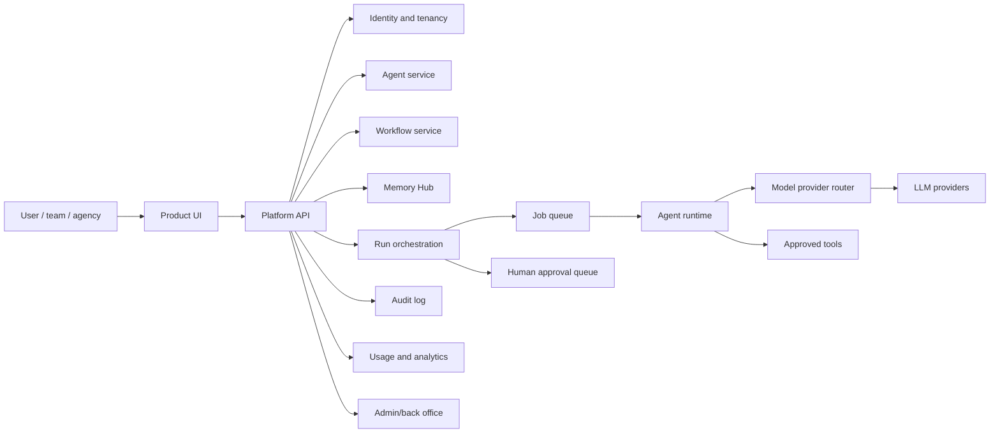

# BuildAI Public Showcase

This public showcase contains sample workflows and architecture for BuildAI. The current product and documentation are at [buildmyagent.app](https://buildmyagent.app).

BuildAI is presented here as a governed AI agent platform for individuals, teams, agencies, enterprises, and partners. This repository demonstrates product strategy, platform architecture, API design, governance patterns, and delivery thinking without exposing private production code, secrets, customer data, or proprietary implementation details.

## What This Shows

- Agent creation and configuration
- Workflow templates and repeatable runs
- Memory Hub for durable context
- Runs, logs, approvals, and audit trails
- Integrations and model provider routing
- Admin and back-office controls
- Analytics, usage, and cost visibility
- Security, governance, and human-in-the-loop controls

## Architecture



## Repository Structure

```text
docs/
  prd.md
  architecture.md
  security.md
  roadmap.md
  demo-scripts.md
api/
  openapi.yaml
database/
  schema.sql
backend/
  service-structure.md
frontend/
  wireframes.md
examples/
  agent-templates.json
  mock-runs.json
```

## Product Surfaces

| Surface | Purpose |
| --- | --- |
| Agents | Create and configure AI agents with instructions, tools, model policy, and deployment target |
| Workflows | Repeatable templates for task execution |
| Memory Hub | Tenant-scoped durable context and knowledge references |
| Runs/logs | Execution traces, status, errors, cost, and outputs |
| Approvals | Human review for high-risk tool calls and external actions |
| Integrations | Tool and provider setup with server-side secret handling |
| Admin | Workspace settings, policies, billing, roles, usage, and audit |
| Analytics | Run success, latency, cost, provider errors, approvals, and adoption |

## Demo Flow

1. Create a workspace.
2. Create an agent from a template.
3. Attach memory context.
4. Configure workflow trigger and model routing policy.
5. Run a workflow.
6. Review logs and approve a high-risk action.
7. Inspect analytics and audit trail.

## Authenticity and Privacy

This repository uses mock data, simplified architecture, and sanitized examples. It is designed to communicate product and architecture judgment, not to expose private production implementation.
