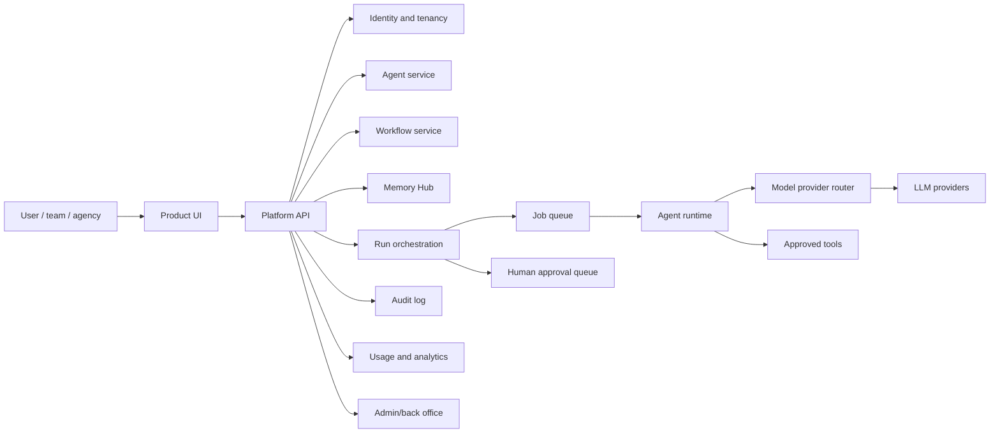

# BuildAI Public Showcase

Status: public sanitized showcase.

Last updated: 11 August 2026.

> Public sanitized showcase version based on real product experience.

BuildAI is presented here as a governed AI agent platform for individuals, teams, agencies, enterprises, and partners. This repository demonstrates product strategy, platform architecture, API design, governance patterns, and delivery thinking without exposing private production code, secrets, customer data, or proprietary implementation details.

## Latest Product Evidence

The current BuildAI product work has expanded the platform from agent configuration and workflow execution into a more explicit trust, evaluation, and delivery control plane:

- **Governed execution evidence:** run contracts, append-only execution events, approval state, authorised-tool decisions, cost provenance, latency, and recorded outcomes are visible at the run boundary.
- **Evaluation scorecards:** versioned suites expose evaluator, sample size, dataset version, prompt/configuration version, model, and code provenance so missing evidence stays visible instead of being inferred.
- **Release gates and detectors:** deployments surface incomplete, stale, failed, or blocked evaluation state before publication; time-bound gate overrides are explicit and auditable.
- **Enterprise routing controls:** budget and model-routing controls connect platform policy to deployment decisions without hiding provider or configuration failures.
- **Deployment surfaces:** share links, website widgets, APIs, and a future self-hosted target are represented with logs, versioning, approvals, and rollback-oriented release thinking.
- **CLI and capability contracts:** authentication and deployment control gates are documented as explicit capabilities, preserving compatibility across the delivery surface.

These updates are reflected as sanitized product and architecture patterns in this repository. The latest implementation remains in the private product checkouts; this showcase does not claim that every provider, credential, worker, or deployment path is enabled for every workspace.

## What This Shows

- Agent creation and configuration
- Workflow templates and repeatable runs
- Memory Hub for durable context
- Runs, logs, approvals, and audit trails
- Integrations and model provider routing
- Admin and back-office controls
- Analytics, usage, and cost visibility
- Security, governance, and human-in-the-loop controls

## Architecture



## Repository Structure

```text
docs/
  prd.md
  architecture.md
  latest-updates.md
  security.md
  roadmap.md
  demo-scripts.md
api/
  openapi.yaml
database/
  schema.sql
backend/
  service-structure.md
frontend/
  wireframes.md
examples/
  agent-templates.json
  mock-runs.json
```

## Product Surfaces

| Surface | Purpose |
| --- | --- |
| Agents | Create and configure AI agents with instructions, tools, model policy, and deployment target |
| Workflows | Repeatable templates for task execution |
| Memory Hub | Tenant-scoped durable context and knowledge references |
| Runs/logs | Execution traces, status, errors, cost, and outputs |
| Approvals | Human review for high-risk tool calls and external actions |
| Integrations | Tool and provider setup with server-side secret handling |
| Admin | Workspace settings, policies, billing, roles, usage, and audit |
| Analytics | Run success, latency, cost, provider errors, approvals, and adoption |

## Demo Flow

1. Create a workspace.
2. Create an agent from a template.
3. Attach memory context.
4. Configure workflow trigger and model routing policy.
5. Run a workflow.
6. Review logs and approve a high-risk action.
7. Inspect analytics and audit trail.

## Authenticity and Privacy

This repository uses mock data, simplified architecture, and sanitized examples. It is designed to communicate product and architecture judgment, not to expose private production implementation.
