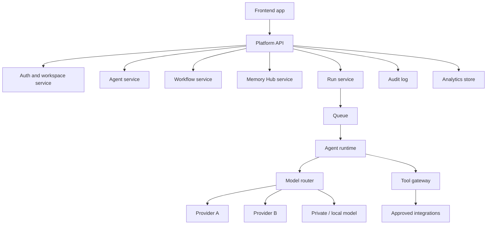
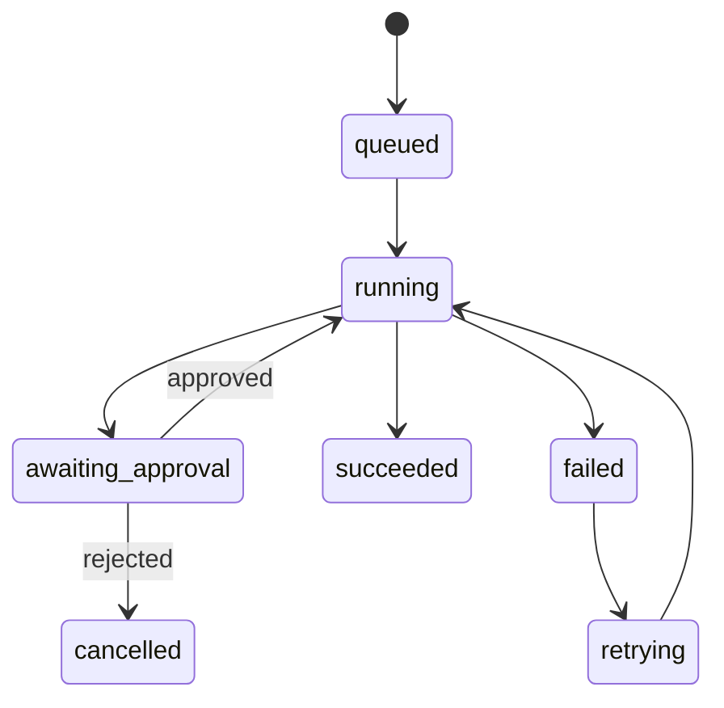

# Architecture

Status: reference architecture

## System Context

## Service Boundaries

| Service | Responsibility |
| --- | --- |
| Platform API | Public API surface, auth checks, workspace context, orchestration |
| Agent service | Agent metadata, instructions, tools, status |
| Workflow service | Templates, parameters, schedules, lifecycle |
| Memory Hub | Durable context, knowledge references, access rules |
| Run service | Run state machine, logs, retries, approvals |
| Agent runtime | Provider calls, tool calls, context assembly |
| Tool gateway | Tool authorization, input validation, execution logging |
| Admin/back office | Policy, usage, billing, account controls |

## Run State Machine

## Design Tradeoffs

- Async run execution improves resilience but requires richer UX states.
- Multi-provider routing improves resilience and cost control but requires normalized observability.
- Memory improves agent usefulness but requires tenant-scoped governance and auditability.
- Human approvals reduce risk but can slow automation.
